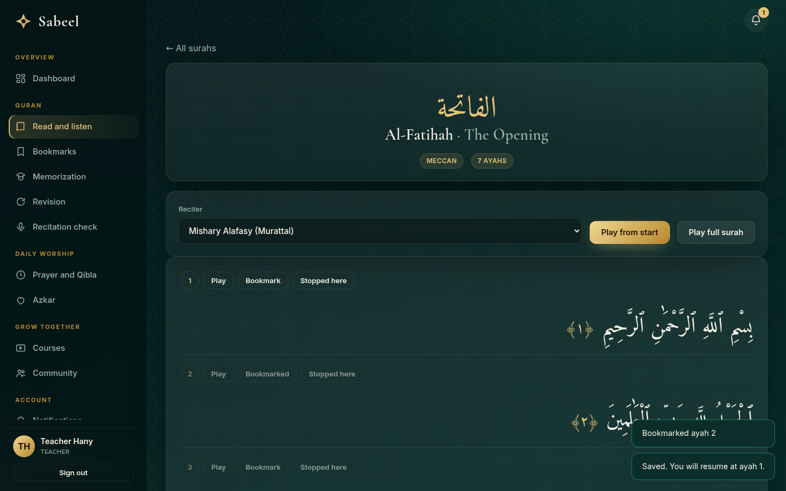
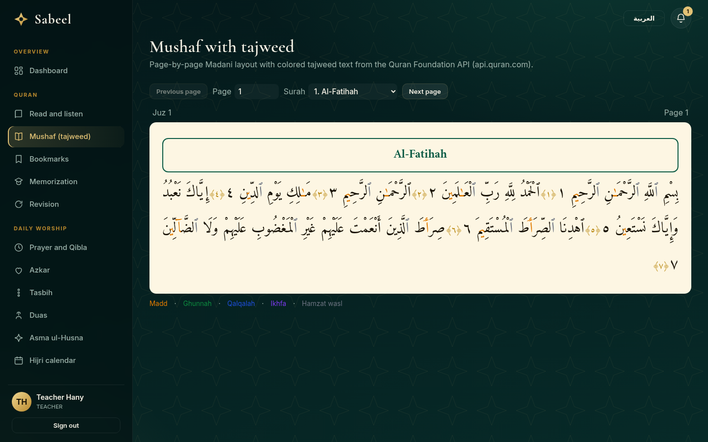
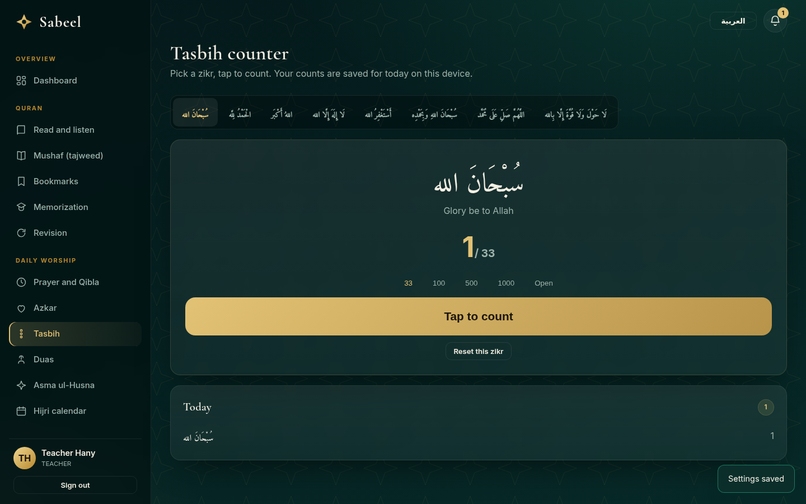
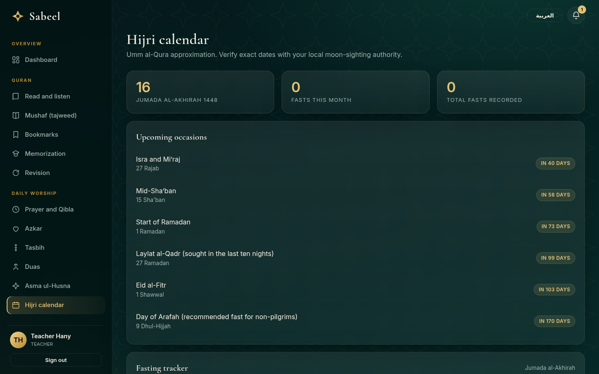
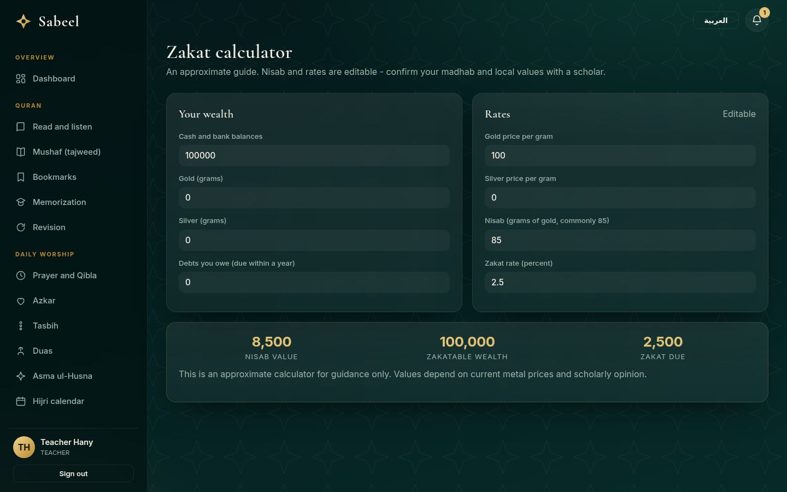

# Sabeel Web

Angular frontend for the Sabeel backend (api-gateway on port 8080 and eleven Spring Boot services). It talks only to the gateway at `/api/v1/**` and covers every API area in the backend's API summary.

Languages: English and Arabic, switchable from a button on every screen. Arabic turns the whole layout right to left. The choice is stored in `localStorage` (`sabeel.lang`) and the first visit follows the browser language.

Stack: Angular 22 (standalone components, signals, lazy routes, functional HTTP interceptor and guards), TypeScript, SCSS, no UI library. Design: deep emerald and gold, glass panels, Quran text in Amiri Quran (loaded from Google Fonts, with serif fallbacks offline).









## What is built

| Area | Screens and behavior | Gateway endpoints used |
|---|---|---|
| Auth | Landing, register (auto sign-in), login, forgot and reset password, email verification link page, silent token refresh on 401, route guards, sign out | `/auth/register, login, refresh, logout, forgot-password, reset-password, verify-email, me` |
| Profile and preferences | Name, image, country, timezone, preferred reciter; push and email toggles, prayer and azkar reminder toggles, reminder times; FCM web token registration | `/users/me`, `/users/me/preferences`, `/users/me/device-tokens` |
| Quran | 114-surah index with filter, full-text search with paging, reader with Uthmani text, reciter picker, per-ayah audio with auto-advance, full-surah audio, bookmarks, "stopped here" reading state, resume from dashboard, reading history | `/quran/surahs, surahs/{id}, ayahs/{surah}/{number}, search, reciters, reciters/{id}/audio, reciters/{id}/surahs/{s}/audio, bookmarks, reading-state, reading-history` |
| Ayah of the day | A daily ayah card on the dashboard with its tafsir inline in English and Arabic, expandable in place, with a link into the mushaf. The ayah text is fetched live from `/quran/ayahs/{surah}/{number}`; a bundled fallback and the tafsir summaries ship with the app because the backend has no tafsir endpoint | `/quran/ayahs/{surah}/{number}` |
| Memorization | Create plan, pause, resume, cancel, progress ring, today's tasks, complete a task with accuracy | `/memorization/plans, plans/me, plans/{id}, plans/{id}/progress, tasks/today, tasks/{id}/complete` |
| Revision | Stats, due items, submit review (accuracy and mistakes), upcoming window | `/revision/due, upcoming, stats, items/{id}/review` |
| Prayer | Daily times, month table, Qibla compass, Hijri date, location and method settings, "use my location" | `/prayer/times, times/month, qibla, hijri, settings` |
| Adhan | Plays the bundled adhan recording aloud at each prayer time while the app is open, with an on/off toggle and a preview. The bundled muezzin is Nasr al-Din Tobar (with a separate Fajr recording). The choice persists on the device. To offer more muezzins, add audio files you hold the rights to under `public/assets/adhan/` and an entry in `src/app/core/adhan.ts` | uses the saved `/prayer/times` schedule |
| Azkar | Categories, per-item counters, completion, streaks, day boundaries from the browser timezone via `?tz=` | `/azkar/today, streaks, items/{id}/progress` |
| Courses | Catalog with category filter and search, course page, enroll, lesson player, progress reporting, rating; teacher tools to create a draft, add lessons and publish | `/learning/courses, courses/{slug}, enrollments/{id}, my-courses, progress, courses/{id}/ratings, lessons, publish` |
| Community | Badges (earned and locked), challenges (join, progress), circles (create, join by code, members), admin challenge creation | `/community/challenges, challenges/{id}/join, challenges/me, circles, circles/join, circles/me, circles/{id}/members, badges, badges/me` |
| Notifications | Bell with unread count that opens the notifications page and, pressed again, closes it and returns to the page you were on; list, mark as read | `/notifications/me`, `/notifications/me/{id}/read` |
| Adhan and prayer reminder | Adhan at each prayer time (Nasr al-Din Tobar, with a separate Fajr recording), preview; separate 15-minute-before-prayer reminder with a generated chime | uses the saved `/prayer/times` schedule |
| Worship tools | Tasbih counter with presets and daily totals; masnoon duas by situation (Hisn al-Muslim); Asma ul-Husna daily card and full list; Hijri calendar with occasions and Monday/Thursday and white-day fasting hints plus a fasting tracker; prayer tracking with qada counters and a qiyam/witr card on the Prayer page; zakat calculator with editable nisab and rates (labeled approximate) | all stored on the device |
| Share ayah | Every ayah in the reader and the ayah-of-the-day card can be shared as text (Web Share API with clipboard fallback) or as a rendered image, and on the dashboard card with optional tafsir | uses the loaded ayah and tafsir |
| Mushaf (tajweed) | Page-by-page Madani-style view (604 pages) with colored tajweed text, page/juz/surah headers, previous/next and jump controls. Text is fetched at runtime from the Quran Foundation API (`api.quran.com`, field `text_uthmani_tajweed`) and cached by the service worker for offline reading | `api.quran.com/api/v4/verses/by_page` |
| Offline (PWA) | Installable progressive web app: service worker precaches the app shell, Quran text and icons, and runtime-caches Quran and azkar API data plus CDN audio and fonts | Angular service worker (`ngsw-config.json`) |

## Languages and RTL

- `src/app/core/i18n.ts` holds the language service, the `t` pipe (English text is the key), the `dt` date pipe, the `nm` name pipe (Arabic or transliterated surah, reciter and azkar names) and the `hj` Hijri pipe. Arabic strings live in `src/app/core/i18n-ar.ts`.
- Switching language sets `lang` and `dir` on `<html>`. Layout uses logical CSS properties, so the sidebar, arrows, toasts and tables mirror correctly. Arabic uses the Cairo and Amiri fonts.
- Backend integration: an HTTP interceptor sends `Accept-Language: ar|en` on every request, so errors, notifications and rendered text come back localized. `POST /auth/register` receives `language`. The language switch syncs `preferredLanguage` with `GET/PUT /users/me` when signed in, and Settings has an interface language select. The pages use the backend fields `revelationTypeAr`, `countryAr`, `styleAr`, `textEn`, `referenceAr`, `titleAr`, `descriptionAr`, `namesAr`, `hijriDateAr`, `hijriAr`, `monthNameAr` and `noteAr`, and fall back to the English value when a field is null. Learning category codes are mapped in the frontend dictionary. User-created content, dates and numbers are not translated by the backend.
- Limit: the real backend was never run against this UI. These fields follow the contract given for the Arabic backend work, and the contract mock mirrors them.
- Numbers stay in Western digits, apart from times and dates, which the browser formats for `ar-EG`.
- Text that the backend writes in English is shown as it arrives unless it is a known value. Translated: enum and status values, the default badges, default azkar references, the Hijri note and month names, and the standard notification titles and bodies. Not translated: course titles and descriptions, user-created circle and challenge names, and any custom server message.

## Run it

Requirements: Node 22 and npm 10.

```bash
npm install
```

### Against the real backend

1. Start the platform: `cd platform && cp .env.example .env && docker compose up --build` (see the backend docs). The gateway listens on `http://localhost:8080` and already allows cross-origin calls.
2. If the gateway is elsewhere, edit `public/config.js`:
   ```js
   window.SABEEL_API_BASE = 'http://localhost:8080/api/v1';
   ```
   This file is read at runtime, so a built bundle can be repointed without rebuilding.
3. `npm start` and open http://localhost:4200.

### Without the backend (contract mock)

`mock-gateway/` is a small in-memory Node server that imitates the gateway contract so the UI can be developed and tested without Docker. It is not the real backend: prayer times are static, the recitation engine only compares a transcript, only four surahs carry Quran text (Al-Fatihah, Al-Ikhlas, Al-Falaq, An-Nas), and tokens are fake.

```bash
npm run mock
```

By default it listens on port 8080. Use `PORT=18080 npm run mock` and set `SABEEL_API_BASE` in `public/config.js` to `http://localhost:18080/api/v1` if 8080 is taken. Registering with an email that starts with `teacher` or `admin` gives that role, which unlocks the teacher and admin screens.

### Build and serve

```bash
npm run build:prod
```

The output is in `dist/sabeel-web/browser`. A `Dockerfile` and `nginx.conf` (single-page-app fallback) are included. They have not been built or run.

## Testing and verification status

What was actually done:

- `ng build --configuration production` succeeds with no errors or warnings (service worker included). Every page is a lazy chunk.
- `ng test`: 39 unit tests pass (Vitest). They cover the language service (translation, parameters, fallback, Hijri, `dir` and persistence), the error mapping, the auth service, the interceptor (bearer header, no header on login, one refresh then retry on 401), the API URL, query and body shapes, and the bundled religious content (99 names count and completeness, tasbih presets, dua references, Hijri conversion round-trip and month lengths, upcoming occasions).
- End-to-end: `npm run e2e` drives the production build in headless Chrome against the contract mock and runs 42 checks across register, reading, bookmarks, share-ayah panel, memorization to revision to badges, prayer (times, adhan, tracker, qada, qiyam), azkar, tasbih, duas, Asma ul-Husna, Hijri calendar and fasting tracker, zakat, prophet stories quiz, tajweed mushaf page, courses, community, notifications, settings, token refresh and sign out. Result: 42 of 42 passed. The tajweed check fetched page 1 live from api.quran.com during the run. Screenshots of every page were inspected, including a 390 px wide mobile layout.
- `npm run e2e:ar` runs the same build in Arabic: it checks that the language switch flips `dir`, persists across reloads, that registration works, that every page opens, that no untranslated English words remain on 18 pages (apart from server-supplied course content, proper nouns and the user's own name), that the sidebar sits on the right, and that the mobile layout does not overflow. Result: 36 of 36 passed. The screenshots were inspected for RTL layout. It also checks that every API call carries `Accept-Language`, that registration in Arabic posts `language: ar`, that switching language while signed in PUTs `preferredLanguage` to `/users/me`, and that azkar text and references follow the language (29 checks).
- Request and response shapes were taken from the backend source (controllers and DTO records in the delivered services), not guessed.

What was not done:

- The frontend has not been run against the real Sabeel services. No Docker daemon or database was available, so the end-to-end run used the mock above. Expect small mismatches to surface on the first real run (for example exact error bodies, how `GET /quran/reading-state` answers before a first read, or the ZonedDateTime format of prayer times). The calls are written to degrade to an empty state rather than crash.
- Audio playback was exercised only up to requesting the audio URL. The audio files come from third-party CDNs (everyayah.com, mp3quran.net).
- The mushaf (tajweed) view was verified rendering live data from api.quran.com. Pages need one online visit each before they are available offline through the service worker cache.
- The Husary and Al-Minshawi muallim reciters stream per-ayah audio from everyayah.com, a public CDN. Verify the licensing for redistribution before shipping them in a product; nothing of theirs is bundled in this zip.
- Not tested: real browser push, FCM, email links, and the Docker image.

## Known limitations

- Mapping a bookmark or history ayah id to its surah assumes the full 6,236-ayah seed (ids are global). With the 27-ayah sample seed, links from the bookmarks page can open the wrong surah. Load the full text with `quran-service/db/seed-full-quran.sh`.
- Draft courses are not listed in the public catalog. After creating a draft, the app opens it directly by slug; whether the backend returns drafts by slug to their owner depends on the learning service.
- Tokens are kept in `localStorage`. For a production deployment, serve over HTTPS, set a strict content security policy, and consider moving refresh tokens to httpOnly cookies on the server side.
- Prayer times and Hijri dates come from the backend's calculations, which differ from official timetables by a few minutes or a day.
- The adhan plays only while the app is open in a tab; a web app cannot fire audio from the background. Browsers may require one tap on Preview before they allow automatic sound.
- The daily tafsir summaries are short mainstream explanations written for this project, not a quoted tafsir source, and cover the 30-ayah rotation only.
- The recitation-check feature was removed at the owner's request. The typed API client still covers `/recitation/evaluations`.

## Religious content sources

- Quran text and reading data: the project backend (Tanzil-verified Uthmani text lineage; Tanzil Quran text is CC BY 3.0, https://tanzil.net/docs/text_license).
- No English translation is bundled in the web app. Translations and tafsir come from the QuranEnc editions served by the backend, see the Sources page.
- Colored tajweed text: Quran Foundation API (`text_uthmani_tajweed`), fetched at runtime under their developer terms (https://api-docs.quran.com/legal/developer-terms/); colors use a conventional tajweed palette, not an official one.
- Masnoon duas: Hisn al-Muslim (Fortress of the Muslim), short widely-circulated supplications with hadith references.
- Asma ul-Husna: the commonly narrated list of 99 names.
- Hijri dates: arithmetic Umm al-Qura approximation computed in the app; verify against local moon-sighting.
- Zakat calculator: 2.5% rate and 85 g gold nisab by default, both editable; approximate guidance, not a fatwa.
- Prophet stories: short summaries from the Quran and well-known seerah, written for this project.

## Quran reader

The Quran entry in the sidebar opens the page-by-page mushaf (604-page Madani layout, tajweed colors from api.quran.com). Previous and next page, swipe, jump to page, surah or juz. Tapping an ayah opens a menu: play, tafsir, translation (QuranEnc editions served by the backend), share as text, share as image with the Sabeel logo,. Page text is fetched per page from api.quran.com and the last 40 pages are kept in local storage; a page that was not opened before cannot be shown offline.

## Adhan audio credits

| File | Recording | Source | License |
| --- | --- | --- | --- |
| `madina.mp3`, `aqsa.mp3`, `alafasy.mp3` | Madinah, Al-Aqsa, Mishary Alafasy | Internet Archive item "(mp3) Collection Adzan of world" by JpnMuslim, https://archive.org/details/Mp3CollectionAdzan | CC BY-NC-ND 4.0. Included unmodified at the project owner's decision; credit to the collection and its uploader |
| `beautiful.mp3` | Adhan by Adam-synagda | Wikimedia Commons, https://commons.wikimedia.org/wiki/File:Beautiful_adhan.ogg | CC0 1.0. Converted from Ogg to 64 kbps mono MP3 |
| `azan.mp3` | Adhan by Andrewler | Wikimedia Commons, https://commons.wikimedia.org/wiki/File:Azan.ogg | CC BY-SA 4.0 (https://creativecommons.org/licenses/by-sa/4.0). Converted from Ogg to 64 kbps mono MP3; this file stays under CC BY-SA 4.0 |

`tobar.mp3` and `tobar-fajr.mp3` (Sheikh Nasr al-Din Tobar, general and Fajr adhan) were supplied directly by the project owner for this project. They were trimmed, denoised and loudness-normalized, and are not from a separately licensed source.

## Project layout

```
src/app/core      api client, auth, interceptor, guards, models, utils (with specs)
src/app/shared    app shell, logo, small UI pieces
src/app/pages     one file per screen
public/config.js  runtime gateway address
mock-gateway/     contract mock for offline development
e2e/              headless Chrome end-to-end runs (English and Arabic) (needs puppeteer-core and Chrome)
```

To run the end-to-end scripts: `npm run build:prod && npm run e2e` (English) and `npm run e2e:ar` (Arabic). Set `CHROME_PATH` if Chrome is not at `/usr/bin/google-chrome`.
