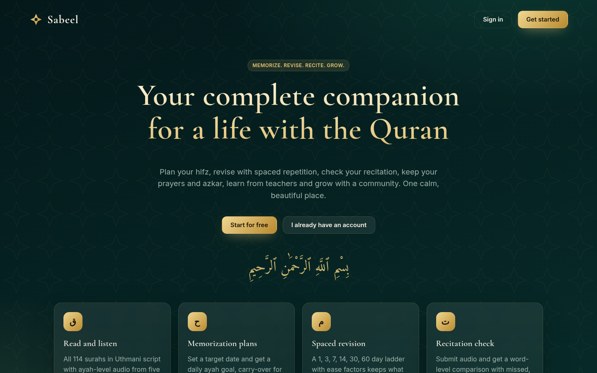
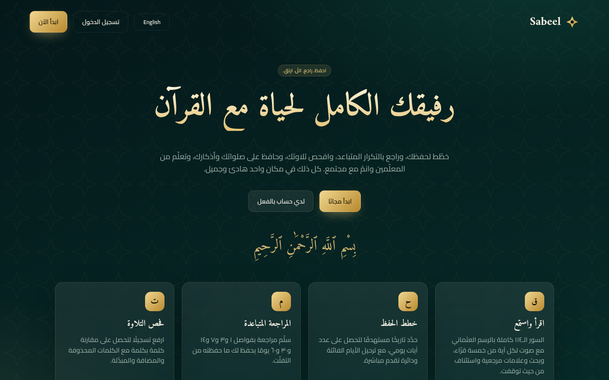
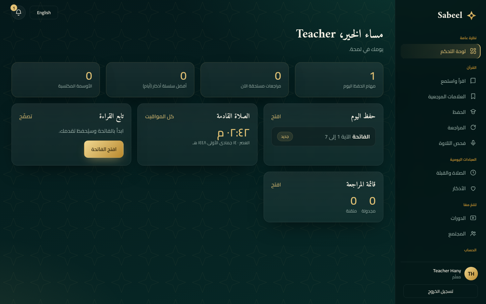
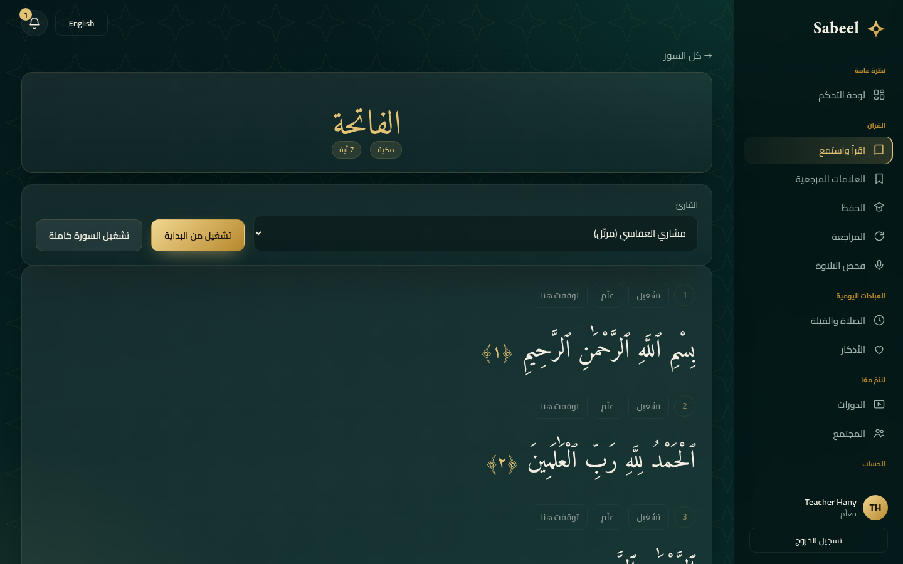

# Sabeel Web

Angular frontend for the Sabeel backend (api-gateway on port 8080 and eleven Spring Boot services). It talks only to the gateway at `/api/v1/**` and covers every API area in the backend's API summary.

Languages: English and Arabic, switchable from a button on every screen. Arabic turns the whole layout right to left. The choice is stored in `localStorage` (`sabeel.lang`) and the first visit follows the browser language.

Stack: Angular 22 (standalone components, signals, lazy routes, functional HTTP interceptor and guards), TypeScript, SCSS, no UI library. Design: deep emerald and gold, glass panels, Quran text in Amiri Quran (loaded from Google Fonts, with serif fallbacks offline).







## What is built

| Area | Screens and behavior | Gateway endpoints used |
|---|---|---|
| Auth | Landing, register (auto sign-in), login, forgot and reset password, email verification link page, silent token refresh on 401, route guards, sign out | `/auth/register, login, refresh, logout, forgot-password, reset-password, verify-email, me` |
| Profile and preferences | Name, image, country, timezone, preferred reciter; push and email toggles, prayer and azkar reminder toggles, reminder times; FCM web token registration | `/users/me`, `/users/me/preferences`, `/users/me/device-tokens` |
| Quran | 114-surah index with filter, full-text search with paging, reader with Uthmani text, reciter picker, per-ayah audio with auto-advance, full-surah audio, bookmarks, "stopped here" reading state, resume from dashboard, reading history | `/quran/surahs, surahs/{id}, search, reciters, reciters/{id}/audio, reciters/{id}/surahs/{s}/audio, bookmarks, reading-state, reading-history` |
| Memorization | Create plan, pause, resume, cancel, progress ring, today's tasks, complete a task with accuracy | `/memorization/plans, plans/me, plans/{id}, plans/{id}/progress, tasks/today, tasks/{id}/complete` |
| Revision | Stats, due items, submit review (accuracy and mistakes), upcoming window | `/revision/due, upcoming, stats, items/{id}/review` |
| Recitation | Request an evaluation from a public audio URL or a transcript, live polling until done, accuracy ring, mistake list, history; every result shows the engine mode label | `/recitation/evaluations` (POST, list, get) |
| Prayer | Daily times, month table, Qibla compass, Hijri date, location and method settings, "use my location" | `/prayer/times, times/month, qibla, hijri, settings` |
| Azkar | Categories, per-item counters, completion, streaks, day boundaries from the browser timezone via `?tz=` | `/azkar/today, streaks, items/{id}/progress` |
| Courses | Catalog with category filter and search, course page, enroll, lesson player, progress reporting, rating; teacher tools to create a draft, add lessons and publish | `/learning/courses, courses/{slug}, enrollments/{id}, my-courses, progress, courses/{id}/ratings, lessons, publish` |
| Community | Badges (earned and locked), challenges (join, progress), circles (create, join by code, members), admin challenge creation | `/community/challenges, challenges/{id}/join, challenges/me, circles, circles/join, circles/me, circles/{id}/members, badges, badges/me` |
| Notifications | Bell with unread count, list, mark as read | `/notifications/me`, `/notifications/me/{id}/read` |

## Languages and RTL

- `src/app/core/i18n.ts` holds the language service, the `t` pipe (English text is the key), the `dt` date pipe, the `nm` name pipe (Arabic or transliterated surah, reciter and azkar names) and the `hj` Hijri pipe. Arabic strings live in `src/app/core/i18n-ar.ts`.
- Switching language sets `lang` and `dir` on `<html>`. Layout uses logical CSS properties, so the sidebar, arrows, toasts and tables mirror correctly. Arabic uses the Cairo and Amiri fonts.
- Backend integration: an HTTP interceptor sends `Accept-Language: ar|en` on every request, so errors, notifications and rendered text come back localized. `POST /auth/register` receives `language`. The language switch syncs `preferredLanguage` with `GET/PUT /users/me` when signed in, and Settings has an interface language select. The pages use the backend fields `revelationTypeAr`, `countryAr`, `styleAr`, `textEn`, `referenceAr`, `titleAr`, `descriptionAr`, `namesAr`, `hijriDateAr`, `hijriAr`, `monthNameAr` and `noteAr`, and fall back to the English value when a field is null. Learning category codes are mapped in the frontend dictionary. User-created content, dates and numbers are not translated by the backend.
- Limit: the real backend was never run against this UI. These fields follow the contract given for the Arabic backend work, and the contract mock mirrors them.
- Numbers stay in Western digits, apart from times and dates, which the browser formats for `ar-EG`.
- Text that the backend writes in English is shown as it arrives unless it is a known value. Translated: enum and status values, the default badges, default azkar references, the Hijri note and month names, and the standard notification titles and bodies. Not translated: course titles and descriptions, user-created circle and challenge names, and any custom server message.

## Run it

Requirements: Node 22 and npm 10.

```bash
npm install
```

### Against the real backend

1. Start the platform: `cd platform && cp .env.example .env && docker compose up --build` (see the backend docs). The gateway listens on `http://localhost:8080` and already allows cross-origin calls.
2. If the gateway is elsewhere, edit `public/config.js`:
   ```js
   window.SABEEL_API_BASE = 'http://localhost:8080/api/v1';
   ```
   This file is read at runtime, so a built bundle can be repointed without rebuilding.
3. `npm start` and open http://localhost:4200.

### Without the backend (contract mock)

`mock-gateway/` is a small in-memory Node server that imitates the gateway contract so the UI can be developed and tested without Docker. It is not the real backend: prayer times are static, the recitation engine only compares a transcript, only four surahs carry Quran text (Al-Fatihah, Al-Ikhlas, Al-Falaq, An-Nas), and tokens are fake.

```bash
npm run mock
```

By default it listens on port 8080. Use `PORT=18080 npm run mock` and set `SABEEL_API_BASE` in `public/config.js` to `http://localhost:18080/api/v1` if 8080 is taken. Registering with an email that starts with `teacher` or `admin` gives that role, which unlocks the teacher and admin screens.

### Build and serve

```bash
npm run build:prod
```

The output is in `dist/sabeel-web/browser`. A `Dockerfile` and `nginx.conf` (single-page-app fallback) are included. They have not been built or run.

## Testing and verification status

What was actually done:

- `ng build --configuration production` succeeds with no errors or warnings. Initial bundle is about 308 kB raw (about 84 kB transferred), every page is a lazy chunk.
- `ng test`: 24 unit tests pass (Vitest). They cover the language service (translation, parameters, fallback, Hijri, `dir` and persistence), the error mapping, the auth service, the interceptor (bearer header, no header on login, one refresh then retry on 401) and the API URL, query and body shapes.
- End-to-end: `npm run e2e` drives the production build in headless Chrome against the contract mock and runs 29 checks across register, reading, bookmarks, memorization to revision to badges, prayer, azkar, courses (student and teacher), community, recitation, notifications, settings, token refresh (20 second token lifetime) and sign out. Result: 29 of 29 passed. Screenshots of every page were inspected, including a 390 px wide mobile layout.
- `npm run e2e:ar` runs the same build in Arabic: it checks that the language switch flips `dir`, persists across reloads, that registration works, that every page opens, that no untranslated English words remain on 13 pages (apart from server-supplied course content and the user's own name), that the sidebar sits on the right, and that the mobile layout does not overflow. Result: 23 of 23 passed. The screenshots were inspected for RTL layout. It also checks that every API call carries `Accept-Language`, that registration in Arabic posts `language: ar`, that switching language while signed in PUTs `preferredLanguage` to `/users/me`, and that azkar text and references follow the language (29 checks).
- Request and response shapes were taken from the backend source (controllers and DTO records in the delivered services), not guessed.

What was not done:

- The frontend has not been run against the real Sabeel services. No Docker daemon or database was available, so the end-to-end run used the mock above. Expect small mismatches to surface on the first real run (for example exact error bodies, how `GET /quran/reading-state` answers before a first read, or the ZonedDateTime format of prayer times). The calls are written to degrade to an empty state rather than crash.
- Audio playback was exercised only up to requesting the audio URL. The audio files come from third-party CDNs (everyayah.com, mp3quran.net).
- Not tested: real browser push, FCM, email links, and the Docker image.

## Known limitations

- Mapping a bookmark or history ayah id to its surah assumes the full 6,236-ayah seed (ids are global). With the 27-ayah sample seed, links from the bookmarks page can open the wrong surah. Load the full text with `quran-service/db/seed-full-quran.sh`.
- Draft courses are not listed in the public catalog. After creating a draft, the app opens it directly by slug; whether the backend returns drafts by slug to their owner depends on the learning service.
- The recitation check is automated speech-to-text plus word alignment. It is not a tajweed assessment, and the UI says so. Audio must be a public http or https URL because the backend downloads it. Browser microphone recording is not implemented.
- Tokens are kept in `localStorage`. For a production deployment, serve over HTTPS, set a strict content security policy, and consider moving refresh tokens to httpOnly cookies on the server side.
- Prayer times and Hijri dates come from the backend's calculations, which differ from official timetables by a few minutes or a day.

## Project layout

```
src/app/core      api client, auth, interceptor, guards, models, utils (with specs)
src/app/shared    app shell, logo, small UI pieces
src/app/pages     one file per screen
public/config.js  runtime gateway address
mock-gateway/     contract mock for offline development
e2e/              headless Chrome end-to-end runs (English and Arabic) (needs puppeteer-core and Chrome)
```

To run the end-to-end scripts: `npm run build:prod && npm run e2e` (English) and `npm run e2e:ar` (Arabic). Set `CHROME_PATH` if Chrome is not at `/usr/bin/google-chrome`.
